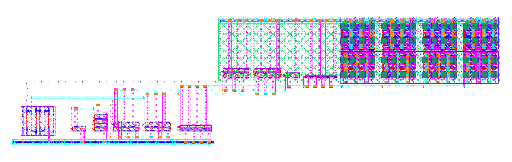

# sky130 LDO regulator: schematic to post-layout

A 1.5 V / 50 mA PMOS low-dropout regulator in **SkyWater sky130** (1.8 V devices), from transistor sizing to a layout that passes the **official open-source DRC and LVS decks** of the PDK, an electromigration check, and **post-layout simulation on an extracted RC netlist**.

Full write-up: [`doc/ldo_sky130.pdf`](doc/ldo_sky130.pdf). Every number in it is produced by the scripts here.



## Results

| | schematic (tt, 27 °C) | post-layout (extracted RC) |
|---|---|---|
| V_OUT at 0.1 / 50 mA (V) | 1.5006 / 1.4959 | 1.5008 / 1.4948 |
| load regulation 0.1→50 mA (mV) | 4.73 | 6.08 |
| dropout at 50 mA (mV) | 142 | 170 |
| quiescent current (µA) | 64.7 | 64.3 |
| PSRR at 1 kHz, 0.1 / 50 mA (dB) | 35.6 / 33.6 | 36.0 / 33.2 |
| phase margin, 0.1 / 50 mA (°) | 89.0 / 80.2 | 89.7 / 101.6 |
| load step 0.1↔50 mA, dip / peak (mV) | 4.64 / 4.62 | 6.01 / 6.01 |

63 schematic corners (tt/ss/ff/sf/fs/ll/hh × −40/27/125 °C × V_IN 1.7/1.8/1.9 V): V_OUT 1.488–1.520 V, lowest phase margin 75.6°.

## Sign-off

| check | tool / deck | result |
|---|---|---|
| DRC | KLayout 0.30.12, `sky130A_mr.drc` (efabless), FEOL + BEOL + off-grid | 0 violations |
| LVS | KLayout, `sky130.lvs` (efabless `sky130_klayout_pdk`), incl. `xhigh_po` resistors | netlists match |
| LVS sanity | 4 deliberately wrong netlists (`layout/lvs_negative_test.py`) | all 4 rejected |
| EM | limits of the SkyWater tech LEF (`sky130_fd_sc_hd.tlef`, Tj = 90 °C), worst-case bound per element | all within limits |
| PEX | KLayout-PEX 0.8.1, 2.5D engine, RC; TICER reduction at 10 ps | post-layout suite re-run |

What the checks changed in the design:
- **EM**: the first layout carried the full 50 mA in 1–2 µm met3 rails (25–50 mA/µm against a 6.8 mA/µm limit). The pass device now sits under met3 + met4 power plates with via2 stacks on every drain/source row.
- **DRC**: Electric does not write the `poly_rs` marker (66/13); without it the resistor contact slots fail `licon.1`. `layout/postproc.py` adds it.
- **Post-layout**: ~0.28 Ω of wiring between the pass drains and the feedback tap raises the phase margin at 50 mA and costs ~14 mV of headroom (analysis in the PDF, `scripts/check_sense_point.py`).

## Circuit

NMOS-input 5-T OTA → NMOS common-source stage → diode-connected PMOS `MD` that mirrors 1:160 into the pass device `MP` (low impedance at the large gate node), plus a small bleeder `MBL`. Divider of 6 identical `xhigh_po` units (+2 dummies). V_REF = 1.0 V and I_BIAS = 10 µA are off chip.

## Layout

Generated by script in **Electric 9.08** (built-in `skywater130` technology): `layout/gen_layout.py` writes a command file that `layout/electric_runtime.bsh` executes inside Electric (layout, schematic for NCC, GDS export). `layout/postproc.py` adds the `poly_rs` marker and pin labels → `layout/ldo_final.gds` (155 × 41 µm).

## Repository

```
scripts/   ngspice netlists and simulations (sim_all.py, corners.py, run_postlayout.py, pex_netlist.py, checks)
layout/    layout generator, GDS, DRC / LVS / EM scripts and reports, extracted netlist
doc/       report source (ldo_sky130.tex.in, build_doc.py fills in the numbers) and PDF
figures/   plots (*_sch = schematic, *_pex = post-layout) and layout pictures
sim/       logs of the runs quoted in the report
```

## Reproducing

Tools: ngspice 46, Electric 9.08, KLayout 0.30.12, KLayout-PEX 0.8.1 (`pip install klayout-pex`), Tectonic for the PDF. The sky130 device models (`sky130_fd_pr`) are not included: set the environment variable `SKY130_FD_PR` to the `models` folder of your copy and run `scripts/make_corner_lib.py` once. Paths to the tools are set at the top of `scripts/spice.py`, `layout/postproc.py`, `layout/run_drc.py` and `layout/run_lvs.py`; the DRC deck is `sky130A_mr.drc` and the LVS deck `sky130.lvs` from [efabless/sky130_klayout_pdk](https://github.com/efabless/sky130_klayout_pdk).

```
cd scripts && python make_corner_lib.py && python sim_all.py && python corners.py
cd ../layout && python gen_layout.py && python run_drc.py && python run_lvs.py && python lvs_negative_test.py
python em_check.py                     # needs the klayout Python module
kpex extract --pdk sky130A --gds ldo_final.gds --cell ldo --2.5D --mode RC --out-dir pex
python -m klayout_pex.netlist reduce --ticer-tau 10p --ticer-max-degree 8 \
    -o pex/ldo_final__ldo/ldo_k25d_pex_netlist_ticer10p.spice pex/ldo_final__ldo/ldo_k25d_pex_netlist.spice
cd ../scripts && python run_postlayout.py
cd ../doc && python build_doc.py
```

## Limitations

Post-layout runs are at the typical corner only (corners on the schematic); one extraction engine, no substrate network; no pads, ESD or fill. Details in the PDF.
